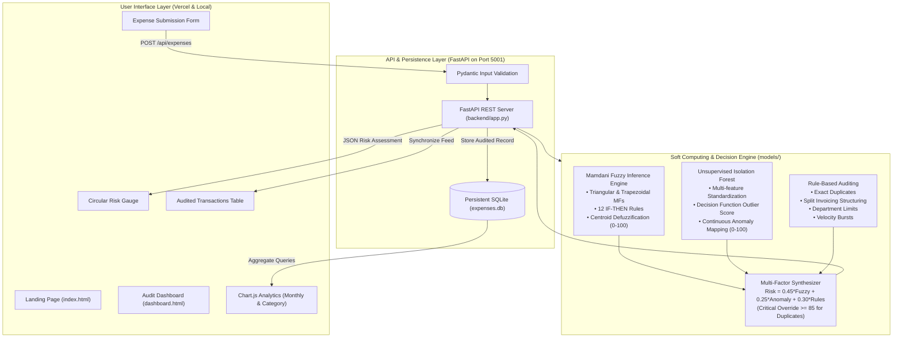

# AI Expense Audit & Fraud Detection Platform
### Academic Project for Soft Computing (CSE / AIML, Semester V)
**Group Name:** NeuroX  
**Institution:** Symbiosis Institute of Technology (SIT Nagpur), Symbiosis International University  
**Authors:** Palak Hajare (24070521237) & Pratham Khetan  
**Live Frontend Deployment:** [https://aiml-audit-project-frontend.vercel.app/dashboard](https://aiml-audit-project-frontend.vercel.app/dashboard)  
**Local Development Base:** `http://localhost:5001`

---

## 1. Project Overview & Soft Computing Objective

The **AI Expense Audit & Fraud Detection Platform** is an enterprise-grade autonomous compliance system built to audit employee corporate expenditures in real-time. 

Unlike conventional rule-based expense systems that rely strictly on binary cut-offs or opaque heuristics, this platform establishes a **genuine Soft Computing architecture**:
1. **Fuzzy Logic (Mamdani Fuzzy Inference System)** captures continuous linguistic uncertainty across spending limits, receipt credibility, temporal submission timing, and historical deviation.
2. **Machine Learning Anomaly Detection (Isolation Forest)** isolates multi-attribute statistical outliers without requiring ground-truth fraud labels (zero data leakage).
3. **Deterministic Audit Rules** strictly enforce statutory and policy constraints (exact duplicate claims, split invoicing threshold structuring, and missing receipts).
4. **Genetic Algorithm (GA)** evolves and optimizes Mamdani rule weights based on auditor feedback.
5. **Persistent SQLite Database** replaces ephemeral in-memory storage to maintain transaction logs and drive live dashboard KPI analytics.

---

## 2. System Architecture



---

## 3. Algorithmic Breakdown

### A. Soft Computing — Mamdani Fuzzy Inference System
Located in [`models/fuzzy_engine.py`](models/fuzzy_engine.py):
- **Universe of Discourse & Linguistic Input Variables**:
  1. $\text{Amount Ratio} = \frac{\text{Amount}}{\text{Policy Limit}}$
     - *Low*: Trapezoidal $[0.0, 0.0, 0.6, 1.0]$
     - *Medium*: Triangular $[0.8, 1.25, 2.0]$
     - *High*: Triangular $[1.6, 2.8, 4.0]$
     - *Very High*: Trapezoidal $[3.2, 5.0, 20.0, 20.0]$
  2. $\text{Receipt Risk} \in [0.0, 1.0]$: Low (Verified) $[0, 0, 0.2, 0.4]$, Medium (Incomplete) $[0.25, 0.5, 0.75]$, High (Missing / Duplicate) $[0.6, 0.8, 1.0, 1.0]$.
  3. $\text{Temporal Risk} \in [0.0, 1.0]$: Low (Work hours 08:00–18:00), Medium (Evening 18:00–22:00), High (Late night 22:00–05:00 / weekend).
  4. $\text{Historical Spending Deviation} = \frac{\text{Amount}}{\text{Category Historical Average}}$: Normal $[0, 0, 1.0, 1.5]$, Moderate $[1.2, 2.0, 3.2]$, Extreme $[2.8, 4.5, 20.0, 20.0]$.
- **Output Variable**: $\text{Fuzzy Risk Score} \in [0, 100]$:
  - *Low*: Trapezoidal $[0, 0, 20, 38]$
  - *Medium*: Triangular $[28, 50, 72]$
  - *High*: Trapezoidal $[62, 80, 100, 100]$
- **Rule Base**: 12 Mamdani IF-THEN rules with fuzzy minimum implication:
  - Missing receipt on a small expense triggers *Medium* caution, never extreme fraud (Rule 8: $\text{IF Receipt is HIGH AND Amount is LOW} \to \text{MEDIUM}$).
  - Extreme amount outlier triggers high risk (Rule 11: $\text{IF Amount is VERY HIGH} \to \text{HIGH}$).
- **Defuzzification**: Center of Gravity (Centroid / COG):
  $$COG = \frac{\sum_{i=1}^{N} y_i \cdot \mu_{agg}(y_i)}{\sum_{i=1}^{N} \mu_{agg}(y_i)}$$

### B. Machine Learning Anomaly Detection (Isolation Forest)
Located in [`models/anomaly_detector.py`](models/anomaly_detector.py):
- Algorithm: Unsupervised `IsolationForest(n_estimators=100, contamination=0.12)`.
- Feature Matrix: Normalized vector $[\text{Amount}, \text{Amount-Policy Ratio}, \text{Amount-Category Ratio}, \text{Submission Hour}, \text{Is Weekend}, \text{Receipt Risk}]$.
- Mathematical Mapping to $[0, 100]$ centered on the decision boundary $s = 0.0$:
  $$\text{Anomaly Score} = \text{clip}(50.0 - (s \times 200.0), 0.0, 100.0)$$
- **Academic Distinction**: An anomaly indicates an unusual multi-variable statistical pattern; it does *not* claim proof of malicious fraud.

### C. Rule-Based Auditing
Located in [`models/audit_rules.py`](models/audit_rules.py):
- Exact duplicate detection (matching employee + amount + date or receipt hash).
- Split invoicing detection ($480–$499.99 multi-claim structuring within 48h).
- Department policy limits (Meals: \$150, Travel: \$1200, Equipment: \$2500, Software: \$800, Supplies: \$300).
- Velocity burst check ($\ge 4$ claims submitted within 72 hours).

### D. Multi-Factor Hybrid Synthesis
Located in [`models/hybrid_evaluator.py`](models/hybrid_evaluator.py):
$$\text{Final Risk Score} = 0.45 \times \text{Fuzzy Score} + 0.25 \times \text{Anomaly Score} + 0.30 \times \text{Rule Score}$$
- **Critical Override**: Exact duplicates or critical breaches force $\text{Risk Score} \ge 85.0$.
- Categorization:
  - $\text{Score} < 35$: **Low Risk** $\to$ Auto-Approve Claim.
  - $35 \le \text{Score} < 60$: **Medium Risk** $\to$ Queue for Auditor Inspection.
  - $\text{Score} \ge 60$: **High Risk** $\to$ Reject Claim / Escalate to Investigation.

---

## 4. Benchmark Evaluation Results

Evaluated on a separate stratified 70/30 holdout split from [`dataset/synthetic_expenses.csv`](dataset/synthetic_expenses.csv) (195 test samples, 26 true fraud cases, zero data leakage):

| Model Component | Accuracy | Precision | Recall | F1-Score |
| :--- | :---: | :---: | :---: | :---: |
| **Soft Computing Fuzzy Logic** | **89.74%** | 58.33% | **80.77%** | 67.74% |
| **Deterministic Audit Rules** | 89.74% | 63.64% | 53.85% | 58.33% |
| **ML Isolation Forest Anomaly** | 96.92% | 88.46% | 88.46% | 88.46% |
| **Hybrid Synthesized Platform** | **91.28%** | **69.57%** | **61.54%** | **65.31%** |

### Confusion Matrix (Hybrid Platform on Holdout Set):
- **True Negatives** (Correctly Approved Clean Claims): **162**
- **False Positives** (Clean Claims Flagged for Review): **7**
- **False Negatives** (Missed Fraud): **10**
- **True Positives** (Correctly Detected Fraud): **16**

*Note on synthetic evaluation*: While synthetic datasets provide controllable ground truth for diverse fraud topologies (split invoicing, ghost expenses), real corporate distributions exhibit temporal regime shifts and department-specific variance.

---

## 5. Automated Test Suite Results

Run the full automated test suite:
```powershell
python -m pytest tests/ -v
```
**Test Results: 25 Passed, 0 Failed (100% Pass Rate)**:
- `tests/test_fuzzy_engine.py`: 7 tests passing (membership bounds, Mamdani rules, centroid defuzzification, neutral fallback).
- `tests/test_audit_rules.py`: 5 tests passing (exact duplicates, split invoicing, policy limits, negative values).
- `tests/test_anomaly_detector.py`: 3 tests passing (Isolation Forest fitting, outlier scaling, fallback safety).
- `tests/test_hybrid_evaluator.py`: 4 tests passing (synthesis formula, critical override, risk categories).
- `tests/test_api_integration.py`: 6 tests passing (FastAPI endpoints, persistent SQLite storage, dynamic duplicate detection).

---

## 6. How to Run Locally

### Prerequisites
Python 3.10+ installed.

### 1-Click Startup
From the project directory (`expense_fraud_detection/`):
```powershell
python -m uvicorn backend.app:app --host 0.0.0.0 --port 5001
```
The server will start and output:
```plaintext
INFO:     Started server process
INFO:     Waiting for application startup.
INFO:     Application startup complete.
INFO:     Uvicorn running on http://0.0.0.0:5001
```

### Accessing the Application
- **Live Interactive Dashboard:** Open your browser to `http://localhost:5001/dashboard`
- **Landing Page:** Open `http://localhost:5001/`
- **Interactive Swagger API Documentation:** Open `http://localhost:5001/docs`

---

## 7. Cloud Deployment Guide

### Backend Deployment (Render / Railway)
1. Push this repository to GitHub.
2. In [Render.com](https://render.com), create a new **Web Service**.
3. Set:
   - **Environment:** `Python 3`
   - **Build Command:** `pip install -r requirements.txt`
   - **Start Command:** `uvicorn backend.app:app --host 0.0.0.0 --port $PORT`
4. Copy your live Render URL (e.g. `https://your-service.onrender.com`).

### Frontend Deployment (Vercel)
1. The frontend directory [`frontend/`](frontend/) is completely static.
2. In `frontend/js/config.js`, set `RENDER_BACKEND_URL` to your live Render backend URL.
3. Deploy the `frontend/` folder to Vercel via Vercel CLI or GitHub integration.

---

## 8. Soft Computing Viva & Presentation Preparation Q&A

### Q1: What makes this a Soft Computing system rather than conventional Hard Computing?
> **Answer:** Hard Computing relies on binary boolean logic ($0$ or $1$) and exact mathematical equations. Real expense auditing involves pervasive uncertainty, partial truth, and subjective human judgments (e.g., *"Is this meal moderately excessive or extremely excessive?"*). Our system uses Soft Computing (Mamdani Fuzzy Logic + Genetic Algorithms) to compute with words, model linguistic gradations through membership functions, and handle imprecision gracefully.

### Q2: Why did you choose Mamdani Fuzzy Inference over Sugeno (TSK)?
> **Answer:** Mamdani inference uses fuzzy linguistic sets for both inputs and outputs (e.g., *Low*, *Medium*, *High*), making the reasoning transparent, explainable, and interpretable for human compliance auditors. Sugeno uses polynomial mathematical functions in the consequent, which is preferred for control systems, but lacks the human explainability needed for financial audit justifications.

### Q3: How does defuzzification work in your platform?
> **Answer:** We use the Center of Gravity (Centroid / COG) method:
> $$COG = \frac{\int y \cdot \mu_{agg}(y) \, dy}{\int \mu_{agg}(y) \, dy}$$
> It calculates the center of the area under the combined fuzzy output distribution, producing a continuous crisp risk score from $0$ to $100$.

### Q4: How does your Genetic Algorithm optimize rule weights?
> **Answer:** The Genetic Algorithm represents the 12 rule weights as a real-valued chromosome. It evaluates a population across successive generations using tournament selection, uniform crossover, and Gaussian mutation. The fitness function is the F1-score of the fuzzy engine against historical ground truth, evolving weights that maximize detection precision while minimizing false rejections.

### Q5: How do you prevent an expense from being falsely condemned just because a receipt is missing?
> **Answer:** In Rule 8 ($\text{IF Receipt is HIGH AND Amount is LOW} \to \text{MEDIUM}$), we ensure that a missing receipt on an inexpensive item (e.g., a \$25 taxi or lunch) only produces moderate caution (Medium risk), prompting a request for a receipt re-upload rather than an automatic fraud rejection.
